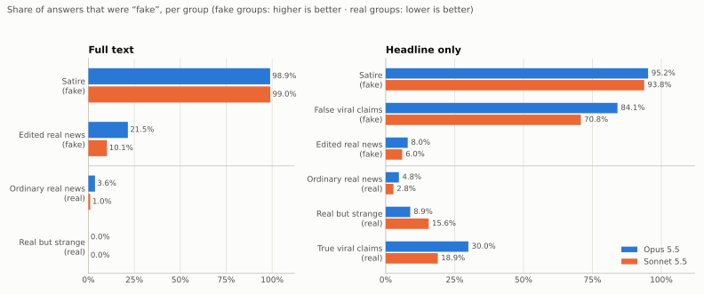
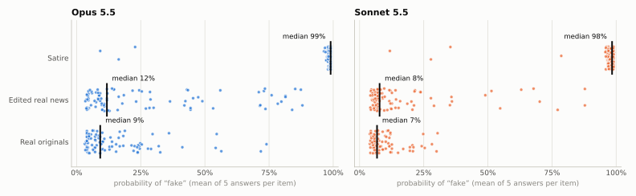

# onion-bench

> **Results, October 2026.** We gave Claude Opus 5.5 and Claude Sonnet 5.5 news from
> after their training cutoff, with no internet access. The models found satire easily.
> A small, believable change to a real article got past them most of the time.

## Results

We collected 1,891 news items from July to October 2026. Each item is real or fake.
Each model answered "real or fake?" five times per item, in separate calls with no tools.
In total, the models gave 19,300 answers.

| | Opus 5.5 | Sonnet 5.5 |
|---|---:|---:|
| Satire called "fake" (full text) | 98.9% | 99.0% |
| Edited real news called "fake" (full text) | 21.5% | 10.1% |
| True viral claims called "fake" (headline only) | 30.0% | 18.9% |
| Ordinary real news called "fake" (full text) | 3.6% | 1.0% |
| MCC, full text (724 items) [95% CI] | 0.77 [0.73, 0.81] | 0.77 [0.74, 0.81] |
| MCC, headline only (1,206 items) [95% CI] | 0.70 [0.66, 0.73] | 0.69 [0.65, 0.72] |

MCC is the Matthews correlation coefficient: 1 is perfect, 0 is chance. The two models
have the same total score (paired McNemar test: p = 1.0 for full text, p = 0.56 for headline only).

<picture>
  <source media="(prefers-color-scheme: dark)" srcset="docs/figures/answers-by-group-dark.svg">
  
</picture>

**Figure 1.** How often each model answered "fake". For fake groups, a perfect model is at 100%.
For real groups, a perfect model is at 0%.

<picture>
  <source media="(prefers-color-scheme: dark)" srcset="docs/figures/confidence-dark.svg">
  
</picture>

**Figure 2.** Probability of "fake" for each item (full text). Edited real news is near its real
originals and far from satire. The models were confident that most edited articles are real.

### What we found

- **The models find satire, not falsehood.** Absurd text is easy. A believable false fact passes.
- **A one-fact edit gets past the models.** A third model (Claude Haiku 5.5) changed one fact in
  real articles, for example "approved" to "refused". Opus caught 21.5% of these fakes and Sonnet
  caught 10.1%. With the headline only, both models were near chance.
- **Real news about new events can look fake.** News that changes what a model knows (for example,
  the death of a senator) received the answer "fake". True viral claims received "fake" in 19–30% of answers.
- **The two models make different errors.** Opus answers "fake" more often. It catches more false
  claims (84% against 71%) but also rejects more true claims (30% against 19%).

### Examples

Percent is the probability of "fake" (mean of five answers). The answer is the majority of five.

| Item | Truth | Opus 5.5 | Sonnet 5.5 |
|---|---|---|---|
| The Onion: "CDC Successfully Eradicates Children" | fake | fake (99%) | fake (99%) |
| BBC, edited: "Plans to redevelop fire-struck hall ~~partly approved~~ **refused**" | fake | real (4%) | real (7%) |
| BBC, edited: "Land Rover driver ~~dies~~ **injured** in Perthshire crash" | fake | real (3%) | real (6%) |
| CBS, edited: "Florida Senate race set between ~~Ashley Moody~~ **Chris Gleason** and Angie Nixon after projected primary wins" | fake | fake (88%) | fake (88%) |
| CBS: "Thune says of Lindsey Graham 'I feel his absence every day' in Capitol ceremony" | real | fake (72%) | fake (70%) |
| BBC: "Canada installs large Lake Ontario sign in latest jab at US" | real | fake (74%) | real (28%) |
| Snopes, rated true: "The YouTube channel of the Miami Heat posted a link to a July 27, 2026, news conference announcing the signing of basketball superstar LeBron James." | real | fake (78%) | fake (71%) |

### More detail

- Full write-up with interactive charts: [`docs/blog/onion-bench-findings.html`](docs/blog/onion-bench-findings.html)
  (download the file and open it in a browser).
- Numbers behind the figures: [`docs/results/summary.json`](docs/results/summary.json).
  Regenerate the figures with `onion-bench figures` after `onion-bench report` for both prompt variants.
- Limits: Claude Haiku 5.5, which made the edited news, is from the same model family as the models
  under test. Some fact-check labels apply to an image, not to the claim text. Portuguese satire
  with full text has only 7 items. See [Known confounds](#known-confounds).

---

## About the benchmark

**Can a model tell satire from real news when it cannot have seen either?**

onion-bench collects satirical ("fake") and real news articles published *after*
the evaluated models' training cutoff. Each model is then asked, with no internet
access, whether each article is real or fake: 5 independent calls per
(model, article). Results are scored with binary-classification metrics.

Evaluated models: `claude-opus-5-5` and `claude-sonnet-5-5` (knowledge cutoff
June 2026 for both, so the collection window starts **2026-07-01**).

## Dataset design

| subset | label | sources | language |
|---|---|---|---|
| `satire` | fake | The Onion, Imprensa Falsa, Inimigo Público (Expresso)¹ | en, pt |
| `misinformation` | fake | claims rated false by Snopes and Observador Fact Check (headline-only) | en, pt |
| `counterfactual` | fake | real control articles with one plausible factual change (LLM-made, checked) | en, pt |
| `real_control` | real | BBC News, CBS News, RTP Notícias, Observador, Notícias ao Minuto | en, pt |
| `real_implausible` | real | Oddity Central, r/nottheonion², LLM-scored and human-reviewed picks from the control pool | en, pt |
| `fact_checked_true` | real | claims rated true by Snopes (headline-only) | en |

¹ expresso.pt sits behind DataDome bot protection, and its robots.txt disallows AI
agents. The scraper does not get around either, so Inimigo Público has to be
brought in by hand (see below).
² Optional. Needs Reddit API credentials.

Sources considered and not used: The Guardian, NPR, AP, France 24, Sapo and
Expresso, because their robots.txt disallows AI user agents; Sky News, Público, JN and
SIC, which block automated requests; Wikinews, which closed in May 2026 and so has
nothing after the cutoff; The Mirror's "weird news", which is not curated
enough. The scraper checks robots.txt for every token passed with
`--robots-agent` (the runs here used `onion-bench` and `Claude-User`).

### What the model sees, and nothing else

Only `title` and `text` ever go into a prompt (`assemble.PROMPT_FIELDS`, enforced by a
unit test). URL, outlet, byline, section, tags and dates are kept as
metadata for traceability and never reach the model.

Text is taken **verbatim** from the publisher's HTML. The only changes are the
HTML-to-text step (whitespace collapsed inside paragraphs, paragraphs joined
by blank lines) and removal of page furniture: ads, captions, share and newsletter
boxes, "read also" links, regional footers. These are removed with per-source selectors and
patterns in `config/sources.yaml`. No words of the article itself are changed.

Some articles name their own outlet in the text: "the BBC understands…",
"o Imprensa Falsa sabe…", "editor do IF". These are **not edited out**. Instead,
`leak_flags` records every outlet name or domain found in the title or text (checked against
every source's patterns), and `eval_eligible=false` keeps those items out of
the eval split. A satire disclaimer in the *title* also blocks; the word
"satire" in a body text is only recorded.

### Harder fakes and sourcing modes

Besides satire, two kinds of fake are less obviously absurd:

- **`misinformation`** comes from viral claims that fact-checkers rated false (Snopes in
  English, Observador Fact Check in Portuguese). They are read from the pages' schema.org
  `ClaimReview`. Claims rated true become **`fact_checked_true`**, which are real but
  sound fake. Only clear-cut verdicts are kept. Statements attributed to named people
  are dropped (the label would be ambiguous), as are claims about a photo or video and
  claims first seen before the window. Items are headline-only (the claim text), so
  they are used only by the `headline_only` variant. Observador published no "Certo"
  (true) verdicts in the window, so `fact_checked_true` is English-only for now.
- **`counterfactual`** items are real post-cutoff articles with one material, plausible
  factual change, made with `onion-bench make-counterfactuals`. The generator is
  `claude-haiku-5-5`, which is not an evaluated model, but it is from the same family.
  It returns exact find/replace edits that are applied in code, so the rest of the
  article stays verbatim. The change must reach the headline and the opening, which
  puts it in every prompt variant. Automatic checks decide eligibility: every find
  matches, the headline and opening change, at most 15% of words change, no outlet
  name is introduced, and no ambiguous short finds. The generator is told not to
  attribute wrongdoing, deaths, illnesses or quotes to real named people.
  `onion-bench review-counterfactuals` records a human verdict. The original article
  stays in the dataset, so each counterfactual has a real twin; the report adds a
  paired metric (how often the edited version is rated more likely fake than its
  original), and balancing keeps pairs together.

Every row says how it was obtained. `sourcing_mode` is one of `publisher_scrape`,
`reddit_linked_scrape`, `manual_html_import`, `manual_index_import`,
`fact_check_claimreview` or `synthetic_counterfactual`. `provenance` holds the details:
fact-checker, verdict and review URL; base article, generator, edits and checks; the
index page an item came from; and so on.

### Real news that sounds fake

Hard negatives come from three routes, and each item records its route in
`selection_method`:

1. **Curated outlets**: sites whose editorial premise is "real but unbelievable"
   (Oddity Central). The Mirror's "weird news" feed was evaluated and dropped,
   because most of its items are ordinary stories.
2. **r/nottheonion**: posts link to the original reports, which are fetched from
   their publishers.
3. **Scored selection**: `score-implausible` rates every real control article
   0–10 for "how much does this sound like a joke?" using a scorer model that is
   **not** being evaluated (`claude-haiku-5-5`). `review-implausible` then asks a human
   to confirm the top candidates. Using an evaluated model, or its eval
   errors, to pick the items would bias the subset towards that model's
   mistakes.

## Eval protocol

- 5 separate API calls per (model, article). No conversation state is shared, and no
  `tools` are passed, so there is no web search or fetch.
- Structured output `{"verdict": "real"|"fake", "p_fake": 0-100}`. `p_fake` is
  used for the ranking and calibration metrics.
- Adaptive thinking (always on for these models), `effort: high` for both. A summary of the
  reasoning is stored with each response for error analysis.
- **No refusal fallbacks.** A fallback would have a different model answer.
  Refusals are recorded as an `invalid` outcome.
- Temperature cannot be set on these models, so the 5 samples use the default sampling.
- Items published on or before a model's knowledge cutoff are skipped for that
  model.
- Runs are resumable. Responses are appended to `results/<run>/responses.jsonl`,
  keyed by (model, item, sample).

The prompt is in `onion_bench/prompts.py` (`PROMPT_VERSION` and `prompt_variant` are stored with
every response). `onion-bench show-prompt --id <item> [--prompt-variant ...]` prints the exact prompt.

**Prompt variants** (`--prompt-variant`, one results directory per variant):

| variant | the model sees |
|---|---|
| `full` | headline + full body text |
| `headline_lead` | headline + the body's opening: whole sentences from the start until ≥ 40 words, verbatim, built the same way for every source |
| `headline_only` | headline alone |

Publishers' own summaries (`og:description`) are deliberately not used. They differ by
outlet (The Onion: a truncated first sentence ending in "…"; BBC, CBS and Observador:
separately written standfirsts; Notícias ao Minuto: a lead cut off with "..."), so they
would be a source tell. `onion-bench compare <run dirs>` tabulates runs side by side.

### Running on a Claude Pro/Max subscription (`--backend claude-cli`)

`onion-bench run --backend claude-cli` sends each sample through a separate
`claude -p` process, which runs on your Claude Code login instead of an API key. It
keeps the same prompt, structured answer, result format and resume behaviour. Each
call uses:

- `--system-prompt <eval prompt>` to replace the Claude Code agent prompt.
- `--tools ""` plus `--disallowedTools "mcp__*"`, so no web, Bash or MCP tools are available.
- `--safe-mode`, so no CLAUDE.md, memory, skills, plugins or hooks are loaded.
- `--no-session-persistence` and `--json-schema`.

The child process runs in an empty directory with a scrubbed environment.
`ANTHROPIC_API_KEY` is never passed to it, so calls can't fall back to API billing.

Every call is checked against its init and result events. A call is recorded as
`invalid_setup` instead of as an answer, and the run stops, if any of these differ
from expected:

- the tools offered (only `StructuredOutput` is allowed),
- the MCP servers,
- the credential source (it must be the subscription),
- the model that actually answered.

The plan's usage is logged on every call, and the run pauses when any usage window
reaches `--pause-at` (default 90%) until that window resets.

Context differences from the API backend, verified by capturing the request:

- Claude Code still adds a one-line SDK preamble, a reminder containing the account
  e-mail, and an environment block (platform, model name, knowledge cutoff, today's date).
- Thinking summaries are not returned.

None of this identifies an article's source. Records carry
`backend: "claude_cli"`, so don't pool them with API-backend runs.

```bash
onion-bench run --backend claude-cli --sample 100 --out results/quick   # ~1,000 calls
onion-bench report --sample 100 --out results/quick
```

### Integrity probes

```bash
onion-bench probe cues          # verdict + self-reported cues + "do you recognise this?"
onion-bench probe memorization  # headline only -> reproduce the lead; overlap with the real lead
onion-bench probe style-swap    # strip Onion house style / give BBC+CBS an Onion dateline and Title Case
```

The probes run on the `claude-cli` backend. Their results are written to
`results/<run>/diagnostics/` and are never mixed into the scored responses.

## Metrics

Positive class = **fake**.

- **Headline:** **MCC** and **balanced accuracy**. Both are insensitive to the
  fake/real ratio, which differs between sources and languages.
- **Recall** (share of satire caught) and **specificity** (share of real news
  trusted) are reported separately. They are the two failure modes: falling for
  satire, and calling real news fake. Precision and F1 are reported as well.
- **AUROC** and **AUPRC** on `p_fake` (threshold-free). **Brier** and **ECE** for calibration.
- Each metric is reported at two levels: **call level** (each of the 5 samples counts) and
  **item level** (majority vote of the 5, ties broken by mean `p_fake`).
- **Strict** variant: invalid answers count as wrong. The invalid rate is reported alongside.
- **Self-consistency** across the 5 samples: majority agreement, unanimous
  rate, and Fleiss' κ.
- 95% CIs come from a **bootstrap over items**, keeping each item's samples together.
- **Model comparison:** paired bootstrap of the MCC difference, and an exact McNemar test on
  per-item correctness, over the items both models answered.
- Views: all items, satire vs control, satire vs implausible-real, per language,
  and per source (rate judged fake).

## Usage

```bash
uv venv && uv pip install -e '.[dev,hub]'

# 1. Collect (respects robots.txt, ~1.5 s between requests per host, HTML cached)
onion-bench scrape --since 2026-07-01                   # all automatic sources
onion-bench scrape --source the_onion --max-items 600   # one source
onion-bench import-html inimigo_publico saved_pages/    # pages saved from a browser
onion-bench reextract                                   # re-parse cache after selector changes

# 2. Build the dataset  ->  data/dataset/onion_bench.jsonl (+ .stats.json)
onion-bench assemble
onion-bench score-implausible && onion-bench review-implausible && onion-bench assemble

# 3. Evaluate (needs ANTHROPIC_API_KEY)
onion-bench run --dry-run              # how many calls
onion-bench run --limit 10             # smoke test
onion-bench run                        # concurrent calls
onion-bench submit-batch               # ...or the Batches API at 50% of the price
onion-bench collect-batch

# 4. Report  ->  results/main/report.md, metrics.json
onion-bench report

# 5. Publish (private by default)
onion-bench push-hub <user>/onion-bench [--text-mode metadata] [--public]
```

## Licensing and redistribution

The article texts belong to their publishers. Before publishing a dataset with full
texts on the Hub, get permission, or publish with `--text-mode metadata` (URLs,
labels, dates and content hashes, so users can re-create the texts with the
scraper and verify them). `push-hub` creates a **private** repo unless `--public` is given.
Scraped text is not committed to this repo (`data/raw`, `data/dataset` and
`data/cache` are git-ignored).

## Known confounds

- **Format and length:** Onion articles are short and use datelines ("ST. LOUIS—").
  BBC and RTP articles are long. The Onion writes Title Case Headlines, while BBC uses
  sentence case. A model could separate them on style alone. Use the per-source
  rates and the implausible-real subset, and consider length-matched analyses or
  real outlets with matching house styles.
- **Language balance:** Portuguese satire is scarce after the cutoff.
  Imprensa Falsa publishes a few pieces a month, and Inimigo Público needs a manual import.
- **Oddity Central** retells stories first reported elsewhere. They are real
  events, but not original reporting.
- **Leak filter scope:** the filter catches outlet names and domains. It does not catch
  subtler tells, such as a paper's house style or recurring fictional characters.
